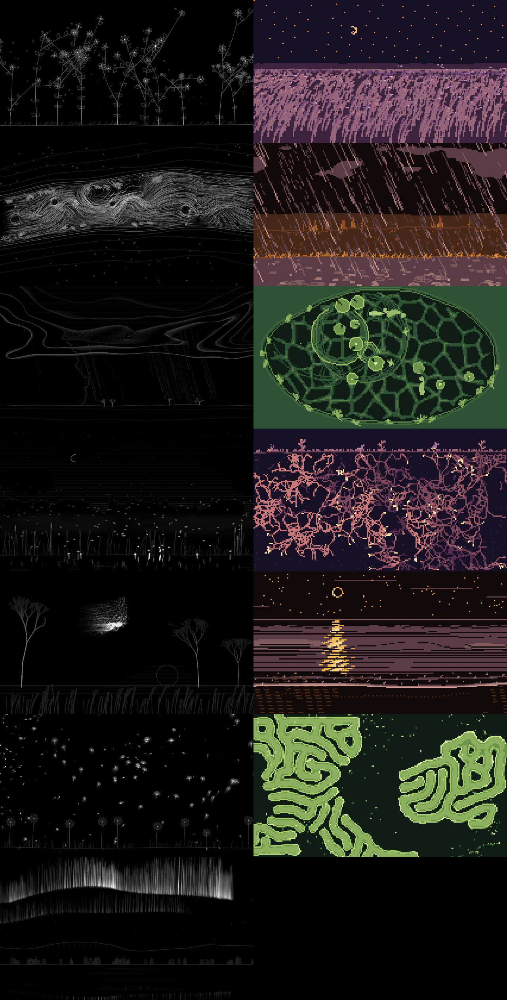

# Understory

Living, generative, nature-inspired visuals for OBS that listen to your music.



Understory adds a video source to OBS. Point it at any audio (Desktop Audio, a mic, a media source)
and it grows a small world on screen: plants that bloom with the bass and sway in the highs, rivers
that run faster when the mids push, rain that falls on the drum hits, storms that charge through long
builds and break with lightning on the biggest hits. Nothing ever freezes — in silence the world keeps
breathing.

## Scenes

| Scene | What the music does |
|---|---|
| Meadow | bass grows stems and opens flowers; highs are wind; petals and seeds drift off on hits |
| Wind | highs drive gust fronts across a grass field; strong gusts shake seeds loose |
| River | mids/level set the flow; hits shed eddies behind stones |
| Rain | hits bring bursts of drops, level sets the drizzle; winter turns it to snow |
| Storm Front | long loud passages charge the clouds; the biggest hits release lightning |
| Pond | every hit drops a ripple; bass swells the caustic light underneath |
| Fireflies | quiet brings a few; dense music makes the swarm synchronise its flashing |
| Mycelium | bass lines spread the network; kicks send nutrient pulses through it |
| Murmuration | melody steers the flock; big transients scatter it |
| Tide | phrase-length swells roll waves in; highs lace the foam |
| Pollen & Seeds | highs lift seeds, sub-bass turns slow vortices |
| Coral | low-mids feed a slowly creeping reaction-diffusion reef |
| Aurora | stereo width and shimmer ripple the curtains; bass surges their light |

### Follow the music

Set **Scene changes → Follow the music** and Understory becomes a director: it learns the character
of your set (how loud, how bright, how percussive, relative to the set itself) and the state of the
living world, and moves to a fitting scene at musical turning points — a drop landing might bring the
murmuration or the storm, a breakdown opens onto the tide, coral or aurora. A long storm charge makes
Storm Front more likely, a wet world favours the river, a summer night favours fireflies. Scenes
dissolve into each other and always stay at least the minutes you set, so each has time to grow.

### One living world

All Understory sources share a hidden ecosystem that remembers your set. A long storm swells the
river. A calm stretch breeds fireflies. Blooming meadows release pollen that feeds the reef and the
flock. Seasons turn with the music you play (about forty minutes of active music is a year): autumn
reddens and sheds leaves, winter turns rain to snow and strengthens the aurora. The world is saved
between OBS sessions; **Reset world** in the source settings starts fresh.

## Looks

- **Ink** — fine single-weight lines at full resolution.
- **Pixel** — low resolution, crisp pixels, six palettes (Moss, Dusk, Riverbed, Ember, Glacier, Lichen).
- **Mono-pixel** — pixel resolution, one colour, sixteen brightness levels.

**Bloom** adds a soft two-scale light around bright lines in Ink — fireflies get halos, aurora and
lightning glow. **Tint** colours Ink and Mono-pixel. **Paper** inverts to dark ink on a light ground.
Style, tint and palette can change live without resetting the scene.

## Controls

- **Scene**, **Listen to** (any audio source).
- **Look:** style, tint, palette, pixel size, ink resolution, bloom, faint-line lift, paper, output size.
- **Nature:** density, speed, reactivity, trails, scene crossfade time, scene changes (stay / cycle in
  order / follow the music), minutes per scene, seed.
- **Listening:** sensitivity, bass / mids / highs gain. The analyser auto-levels, so quiet and loud mixes both work.
- **World:** share the living world (on by default), world speed, reset world.
- **Hotkeys** (Settings → Hotkeys): next scene, previous scene, cycle style.

## Performance

Each Understory source draws on its own worker thread; OBS's video thread only uploads finished
frames, so a busy moment in a scene never stalls your stream. Ink draws at 0.67× the output size by
default (a 1080p source draws at ~720p and upscales smoothly); raise **Ink resolution** for finer lines.

## Install (macOS, Apple Silicon, OBS 32)

```sh
sh tools/install.sh        # fetches headers, builds, copies understory.plugin into
                           # ~/Library/Application Support/obs-studio/plugins/
```

Restart OBS, then **Sources → + → Understory (living nature)**.

## Develop

```sh
sh tools/fetch-deps.sh                                   # OBS headers + SIMDe into deps/
cmake -S . -B build -DUNDERSTORY_BUILD_PLUGIN=OFF && cmake --build build -j
./build/us_tests                                          # core + every scene × every style
./build/us_render --scene storm --synth --style ink --prewarm 40 --start 40 --seconds 10 --every 3 --out out/storm
./build-obs/obs_host_test build-obs/understory.plugin out/host meadow 4   # loads into OBS.app's libobs headless
US_BIG=1 ./build-obs/obs_host_test build-obs/understory.plugin out/host storm 5  # 1080p: fails if OBS lags
```

`us_render` renders any scene with real audio (`ffmpeg -i song.wav -f f32le -ac 2 -ar 48000 song.f32`
then `--audio song.f32`) or a built-in test track (`--journey 30` runs the follow-the-music director with a 30 s minimum), to frames you can turn into GIFs or video.
See `docs/design.md` for the architecture and `docs/scene-guide.md` for writing new scenes.
